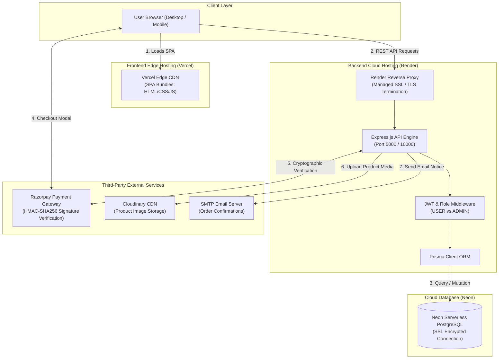

# EpicCart — Modern Full-Stack E-Commerce Platform

[](https://epiccart.vercel.app/)
[](https://epiccart-backend.onrender.com/)
[](https://neon.tech/)
[](https://razorpay.com/)
[](https://opensource.org/licenses/ISC)

EpicCart is a production-quality, responsive e-commerce marketplace featuring secure user authentication, persistent cart and wishlist state, automated inventory management, cryptographic payment verification via Razorpay, administrative analytics, and a multi-container cloud deployment architecture.

- **Live Storefront**: [https://epiccart.vercel.app/](https://epiccart.vercel.app/)
- **Live Backend API**: [https://epiccart-backend.onrender.com/](https://epiccart-backend.onrender.com/)
- **Live Health Endpoint**: [https://epiccart-backend.onrender.com/api/health](https://epiccart-backend.onrender.com/api/health)

---

## Table of Contents
1. [Technology Stack](#1-technology-stack)
2. [Actual Repository Folder Structure](#2-actual-repository-folder-structure)
3. [Architecture Map & Mermaid Diagram](#3-architecture-map--mermaid-diagram)
4. [Cloud Deployment Architecture](#4-cloud-deployment-architecture)
5. [Local Development Instructions](#5-local-development-instructions)
6. [Docker & Containerization Breakdown](#6-docker--containerization-breakdown)
7. [Docker Compose Service Orchestration](#7-docker-compose-service-orchestration)
8. [Kubernetes & YAML Manifests (Demonstration)](#8-kubernetes--yaml-manifests-demonstration)
9. [Jenkins CI/CD Pipeline](#9-jenkins-cicd-pipeline)
10. [Environment Variables & Secret Security](#10-environment-variables--secret-security)
11. [Build & Safe Validation Commands](#11-build--safe-validation-commands)
12. [Known Limitations & Cold-Start Considerations](#12-known-limitations--cold-start-considerations)
13. [Two-Minute Class Presentation Script](#13-two-minute-class-presentation-script)
14. [Top 8 Viva Questions & Concise Answers](#14-top-8-viva-questions--concise-answers)

---

## 1. Technology Stack

| Layer | Technologies Used |
| :--- | :--- |
| **Frontend Storefront** | React 19, Vite 8, React Router v7, Lucide Icons, React Hot Toast, Vite PWA |
| **Backend API** | Node.js (v20), Express.js (v5), Prisma ORM (v5), Multer, Nodemailer, bcryptjs, jsonwebtoken |
| **Database** | PostgreSQL (Neon Serverless with SSL Connection Pooling) |
| **Payments** | Razorpay Node.js SDK with client modal and server-side HMAC-SHA256 signature verification |
| **Image Hosting** | Cloudinary API integration for administrative product image management |
| **Containerization** | Docker (Multi-stage Node.js + Nginx Alpine for frontend; Debian Bookworm slim for backend) |
| **Local Orchestration** | Docker Compose v3.8 (`epiccart-frontend`, `epiccart-backend`, `epiccart-db`) |
| **Cluster Orchestration** | Kubernetes YAML Manifests (`k8s/`: Deployments, Services, ConfigMaps, Secrets, Ingress) |
| **CI/CD Pipeline** | Jenkins Declarative Pipeline (`Jenkinsfile`) & Git-triggered Vercel/Render deployments |

---

## 2. Actual Repository Folder Structure

```
EpicCart - eCommerce Platform/
├── backend/
│   ├── config/               # External service configurations (Cloudinary SDK)
│   ├── controllers/          # Express route controllers (Auth, Products, Orders, Payments, Admin)
│   ├── middleware/           # JWT authentication guards & admin audit logging
│   ├── prisma/               # Database schema (schema.prisma) & catalog seeder scripts
│   ├── routes/               # Express REST route declarations
│   ├── utils/                # Helper utilities (sendEmail.js for order confirmations)
│   ├── .dockerignore         # Docker context exclusion rules (excludes node_modules, .env)
│   ├── .env.example          # Environment variable template for backend
│   ├── app.js                # Express app setup and middleware pipeline
│   ├── Dockerfile            # Container definition for Node.js backend
│   ├── package.json          # Backend npm dependencies and scripts
│   └── server.js             # Main server entrypoint (port listener & CORS)
├── frontend/
│   ├── public/               # Static public assets, favicons, marketplace hero image
│   ├── src/
│   │   ├── assets/           # Bundled vector assets
│   │   ├── components/       # Reusable UI components (ProductCard, Navbar, Footer, Hero)
│   │   ├── context/          # React context providers (AuthContext, CartContext, WishlistContext)
│   │   ├── pages/            # Application views (Home, Shop, Cart, Checkout, Orders, Admin Portal)
│   │   ├── services/         # API fetch abstractions connecting to backend endpoints
│   │   ├── App.jsx           # Client-side router declarations
│   │   ├── index.css         # Design system tokens and global styles
│   │   └── main.jsx          # React DOM root entrypoint
│   ├── .dockerignore         # Docker context exclusion for frontend (prevents copying host node_modules)
│   ├── .env.example          # Frontend environment template
│   ├── .env.production       # Production API URL pointer (Render backend)
│   ├── Dockerfile            # Multi-stage build (Node build stage -> Nginx Alpine runtime)
│   ├── nginx.conf            # Nginx web server config with SPA client-side routing fallback
│   ├── package.json          # Frontend dependencies and build scripts
│   ├── vercel.json           # Vercel SPA rewrite routing configuration
│   └── vite.config.js        # Vite compiler and PWA plugin settings
├── k8s/                      # Kubernetes demonstration manifests (Deployments, Services, Ingress)
│   ├── backend-configmap.yaml
│   ├── backend-secret.yaml
│   ├── backend-deployment.yaml
│   ├── backend-service.yaml
│   ├── frontend-deployment.yaml
│   ├── frontend-service.yaml
│   ├── ingress.yaml
│   ├── kustomization.yaml
│   └── README.md
├── docker-compose.yml        # Multi-container local orchestration (Postgres, Backend, Frontend)
├── Jenkinsfile               # Declarative multi-stage CI/CD pipeline
├── PRESENTATION_STUDY_GUIDE.md # Line-by-line examiner study guide
├── Project - Documentation.md# Development chronology and audit history
└── README.md                 # Primary project documentation
```

---

## 3. Architecture Map & Mermaid Diagram



---

## 4. Cloud Deployment Architecture

EpicCart operates on a modern, decoupled cloud architecture designed to leverage specialized managed services:

1. **Frontend Hosting (Vercel)**:
   - Hosted at `https://epiccart.vercel.app/`.
   - Continuous Git deployment automatically compiles the React application using `vite build` on every push to the `main` branch.
   - Client-side Single Page Application (SPA) routing is handled by `frontend/vercel.json` rewriting all incoming paths to `/index.html`.

2. **Backend Hosting (Render)**:
   - Hosted at `https://epiccart-backend.onrender.com/`.
   - Containerized Node.js web service running `npm start` (`node server.js`).
   - Automated HTTPS termination, live `/api/health` monitoring, and dynamic port injection.

3. **Database (Neon Serverless PostgreSQL)**:
   - Scalable serverless PostgreSQL instance running on AWS.
   - Connected via Prisma ORM using SSL-encrypted connection pooling (`?sslmode=require`).

4. **Payment Integrity (Razorpay)**:
   - Payments are initiated on the backend to obtain an authenticated `razorpay_order_id`.
   - After user completes payment in the modal, the backend independently verifies the transaction using HMAC SHA-256 cryptographic hashing (`crypto.createHmac`) before marking any order as `PAID`.

---

## 5. Local Development Instructions

### Method A: Using Docker Compose (Recommended for Full-Stack)
Ensure Docker Desktop is running, then run in root:
```bash
docker-compose up --build
```
- Access Frontend: `http://localhost:80`
- Access Backend API: `http://localhost:5000`
- Access Local Database: `localhost:5432`

### Method B: Manual Local Setup (Without Docker)

#### 1. Start Backend:
```bash
cd backend
npm install
# Ensure .env is populated based on .env.example
npx prisma generate
npx prisma db push
npm run dev
```

#### 2. Start Frontend:
```bash
cd frontend
npm install
npm run dev
# App opens at http://localhost:5173
```

---

## 6. Docker & Containerization Breakdown

### Backend Dockerfile (`backend/Dockerfile`)
- **Base Image**: `node:20-bookworm-slim` (lightweight Debian-based Node.js runtime).
- **Prisma Requirement**: Explicitly installs `openssl` via `apt-get` so the Prisma C++ query engine can run on Linux.
- **Layer Caching**: Copies `package*.json` and `prisma/schema.prisma` first to cache dependency installation (`npm install`) across code changes.
- **Port**: Exposes `5000`.

### Frontend Dockerfile (`frontend/Dockerfile`)
- **Multi-Stage Build**:
  - **Stage 1 (Build)**: `node:18-alpine` compiles the React JSX and CSS assets into `/app/dist` via `npm run build`.
  - **Stage 2 (Runtime)**: `nginx:stable-alpine` takes **only** the static files and serves them via Nginx on port 80.
  - **Size Benefit**: The final container image is ~25MB (instead of ~450MB with Node.js), drastically reducing attack surface and boot time.

---

## 7. Docker Compose Service Orchestration

The `docker-compose.yml` orchestrates three coordinated services on a private Docker bridge network:
1. `db`: Runs `postgres:15-alpine` with a persistent named volume `pgdata` so database records survive container recreation.
2. `backend`: Builds `./backend`, connects to database via internal DNS hostname `db:5432`, pushes schema via `npx prisma db push`, and listens on port 5000.
3. `frontend`: Builds `./frontend`, mounts `nginx.conf`, and routes host port 80 to container port 80.

---

## 8. Kubernetes & YAML Manifests (Demonstration)

> **Important Distinction**: In live production, EpicCart is hosted on Vercel, Render, and Neon. The manifests in `k8s/` provide a production-ready **academic and DevOps demonstration architecture** showing how the platform is orchestrated in enterprise Kubernetes environments (Minikube, Kind, AWS EKS, or GKE).

Located in `k8s/`:
- `backend-configmap.yaml`: Non-sensitive settings (`PORT`, `NODE_ENV`, `FRONTEND_URL`).
- `backend-secret.yaml`: Secrets template (`DATABASE_URL`, `JWT_SECRET`, payment keys).
- `backend-deployment.yaml`: 2 Pod replicas with resource requests/limits and `/api/health` liveness/readiness probes.
- `backend-service.yaml`: `ClusterIP` internal load balancer on port 5000.
- `frontend-deployment.yaml`: 2 Pod replicas serving Nginx on port 80.
- `frontend-service.yaml`: `LoadBalancer` service providing public HTTP ingress.
- `ingress.yaml`: L7 path routing (`/api` $\to$ backend, `/` $\to$ frontend).
- `kustomization.yaml`: Atomic manifest grouping.

---

## 9. Jenkins CI/CD Pipeline

The `Jenkinsfile` provides an automated Declarative Pipeline structure:
- **Checkout**: Pulls source branch from version control (`checkout scm`).
- **Backend Install & Test**: Validates backend dependencies (`npm install`).
- **Frontend Install & Build**: Executes `npm run build` to catch syntax or bundle compilation errors early.
- **Docker Image Build**: Prepares backend and frontend container tags for registry publishing.
- **Post Actions**: Reports pipeline success or failure notifications.

---

## 10. Environment Variables & Secret Security

- **Strict Secret Isolation**: Backend secrets (`DATABASE_URL`, `JWT_SECRET`, `RAZORPAY_KEY_SECRET`) are never committed to Git.
- **Templates**: `.env.example` files in both `backend/` and `frontend/` provide developer blueprints without exposing real credentials.
- **Frontend Safe Scope**: Frontend only reads variables prefixed with `VITE_` (`VITE_API_URL`, `VITE_RAZORPAY_KEY_ID`). Private keys are physically absent from the client-side JavaScript bundle.

---

## 11. Build & Safe Validation Commands

Commands you can run safely in class to demonstrate codebase integrity:

```bash
# 1. Compile frontend production bundle (Proves zero React build errors)
npm --prefix frontend run build

# 2. Syntax validation for backend (Proves zero Node.js syntax errors)
node -c backend/server.js
node -c backend/app.js

# 3. Client-side Kubernetes YAML validation (Runs without touching any cluster)
kubectl kustomize k8s/

# 4. Check Docker version & Compose CLI
docker --version
docker-compose --version

# 5. Live production health check (Queries live Render backend)
curl https://epiccart-backend.onrender.com/api/health
```

---

## 12. Known Limitations & Cold-Start Considerations

- **Render Free-Tier Spin-Down**: The live backend on Render automatically enters sleep mode after 15 minutes of inactivity. When a new user accesses the live website, the initial API call takes ~50 seconds for Render to spin up the container. Subsequent requests execute in milliseconds.
- **Neon Database Suspension**: Neon serverless Postgres compute pauses during inactivity, with a resume latency of ~1–2 seconds upon incoming connection.

---

## 13. Two-Minute Class Presentation Script

> *"Good morning, Professor and classmates. Today I am presenting **EpicCart**, a full-stack, cloud-native e-commerce platform that I built, containerized, and deployed.*
>
> *Our architecture follows a decoupled, three-tier model:*
> - *On the frontend, we built a responsive React Single Page Application using Vite. It is deployed live to **Vercel's global Edge CDN**.*
> - *Our backend is a REST API powered by **Node.js and Express**, communicating with a **Neon serverless PostgreSQL database** via the **Prisma ORM**. The API is deployed live on **Render**.*
> - *For payments, we integrated **Razorpay** with server-side cryptographic HMAC-SHA256 signature verification to prevent tampering.*
>
> *From a DevOps perspective, the application is fully containerized:*
> - *Our backend Dockerfile utilizes a lightweight Debian slim base with OpenSSL support for Prisma.*
> - *Our frontend Dockerfile implements a **multi-stage build**, compiling the React application in Node.js and transferring only the static output into an **Nginx Alpine image**, reducing the runtime container footprint from 450 megabytes to just 25 megabytes.*
> - *For local multi-container orchestration, we configured **Docker Compose** to coordinate the frontend, backend, and a PostgreSQL database with persistent volume storage.*
> - *For enterprise cloud orchestration, we authored a complete **Kubernetes manifest suite** in the `k8s/` directory. It defines Deployments with two replicas for self-healing and zero-downtime updates, ClusterIP and LoadBalancer Services, ConfigMaps for environment configuration, and Ingress routing.*
> - *Finally, our **Jenkinsfile** demonstrates a declarative CI/CD pipeline that automates checkout, linting, frontend building, and Docker image creation.*
>
> *I am ready to demonstrate the code, live application, and answer any questions. Thank you."*

---

## 14. Top 8 Viva Questions & Concise Answers

1. **What is the difference between Docker and a Virtual Machine?**  
   *VMs virtualize the hardware and run full guest operating systems; Docker containers virtualize the OS, sharing the host Linux kernel through namespaces and cgroups for millisecond boot times and minimal RAM usage.*

2. **Why did you use a multi-stage Docker build for the frontend?**  
   *To keep production images small and secure. The Node.js compiler is discarded after building; only static HTML/CSS/JS files are copied into a 25MB Nginx Alpine container.*

3. **Why do we copy `package.json` before `COPY . .` in Dockerfiles?**  
   *To leverage Docker layer caching. If source code changes but dependencies don't, Docker skips `npm install`, drastically accelerating build times.*

4. **What is the purpose of Kubernetes Liveness and Readiness probes?**  
   *Readiness probes ensure traffic is only sent to Pods that are fully initialized and ready. Liveness probes restart containers if the process deadlocks or crashes.*

5. **Why use an Ingress controller in Kubernetes instead of multiple LoadBalancers?**  
   *A single Ingress controller provides path-based routing (`/api` vs `/`) using one public IP, saving cloud costs compared to paying for separate cloud load balancers.*

6. **What is the difference between Docker Compose and Kubernetes?**  
   *Docker Compose is for single-host local development orchestration; Kubernetes is for multi-node distributed cluster orchestration with auto-scaling and self-healing.*

7. **How does your frontend handle client-side routing on Vercel and Nginx?**  
   *Via SPA rewrites. On Vercel, `vercel.json` rewrites all paths to `/index.html`. On Nginx, `try_files $uri $uri/ /index.html` prevents 404 errors when users refresh deep URLs like `/products`.*

8. **How do you ensure payment integrity with Razorpay?**  
   *The backend creates the order and cryptographically validates the HMAC-SHA256 signature returned by Razorpay using our private secret before updating the database order status to `PAID`.*
